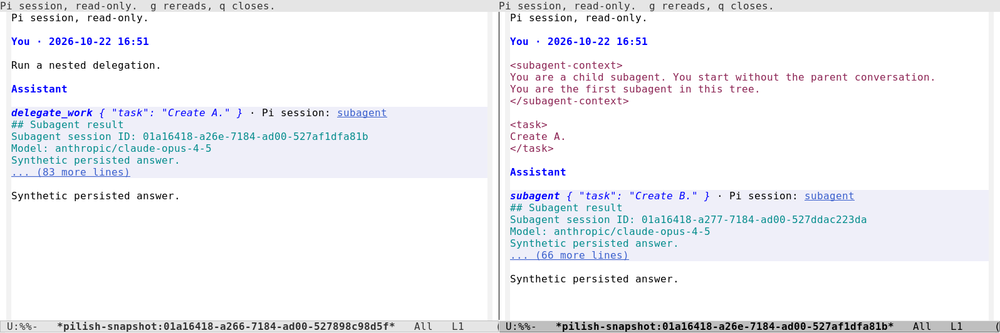

#+title: Pilish
#+author: Daniel Nouri
#+options: toc:nil num:nil

#+html: 
#+html: 
#+html: 
#+html: 
#+html: 
#+html: 

#+html: 
<em>Jump to:</em> <a href="#quick-start">Quick start</a> ·
#+html: <a href="#everyday-workflow">Everyday workflow</a>
#+html: (<a href="#composing-prompts">composing prompts</a>,
#+html: <a href="#reading-output">reading output</a>,
#+html: <a href="#sessions-and-context">sessions</a>,
#+html: <a href="#common-keys">shortcuts</a>) ·
#+html: <a href="#troubleshooting">Troubleshooting</a> ·
#+html: <a href="#how-it-compares">Comparison</a> ·
#+html: <a href="#advanced-features-and-configuration">Advanced</a> ·
#+html: <a href="#development">Development</a>

* What is Pilish?

#+html: 

Pilish is an Emacs frontend for [[https://pi.dev][Pi]], an open and
extensible coding agent.  A session uses two windows.  The
conversation renders as Markdown in the top window, and you compose
your next prompt in an ordinary Emacs buffer in the bottom one.

Because the prompt is a normal buffer, your editing habits apply
directly.  Write multi-line prompts, paste from other buffers, use the
kill ring, keyboard macros, registers, spell checking, Evil, and
anything else your setup gives you.  You can keep writing while the
answer streams in above, and scroll, search, and copy from previous
output with the keys you already use everywhere else.

Pi's terminal UI and Pilish use the same =pi= CLI.  Your model
providers, sessions, skills, and prompt templates carry over unchanged.
Pi extensions work with basic UI support.  See =Extension support=
under Advanced for the supported features and limits.

#+html: 
#+html: 
<small>Video music: "Electrodoodle" by Kevin MacLeod
#+html: (<a href="https://incompetech.com">incompetech.com</a>),
#+html: licensed under <a href="https://creativecommons.org/licenses/by/4.0/">CC BY 4.0</a>.</small>

#+html: 
* Quick start

If you already have Emacs 29.1 or later with tree-sitter support, this
is the shortest path to a working session.

** Requirements

- Emacs 29.1 or later, built with tree-sitter support
- Node.js 22.19 or later for the Pi CLI
- [[https://pi.dev][pi coding agent]] =@earendil-works/pi-coding-agent@1.0.0= or later,
  installed and in =PATH= on the host where Pi runs
- Pi CLI authentication: a provider API key, or a one-time =/login=
  run in a terminal (see below)
- A C compiler if Emacs needs to compile tree-sitter grammars

Upgrade older Pi installations before using Pilish, for example with
=npm install -g @earendil-works/pi-coding-agent@latest=.

** Install pi and authenticate

#+begin_src bash
# Install the pi CLI
npm install -g @earendil-works/pi-coding-agent

# Or with mise
mise use -g npm:@earendil-works/pi-coding-agent@latest

# Authenticate the CLI: either set a provider API key (see below), or
# run `pi` interactively in a terminal and type `/login`.
#+end_src

Pi authenticates in one of two ways:

- *Subscription or API key* via =/login=: =/login= is interactive and
  unavailable from Emacs, so run plain =pi= once in a terminal and
  type =/login=.  You can then pick a subscription such as ChatGPT
  Plus/Pro, or choose a provider and enter its API key.  Credentials
  are stored in =~/.pi/agent/auth.json= and auto-refresh, so later
  Emacs sessions pick them up automatically.

- *Provider API key, no terminal login:* export a provider
  environment variable, for example ~export ZAI_API_KEY=...~, or add an entry
  to =~/.pi/agent/auth.json=.  Pi supports many providers including
  DeepSeek, OpenAI, and Z.AI.  See the
  [[https://pi.dev/docs/latest/providers][providers documentation]] for the full set and its
  environment variables.

Either way, your provider bills usage per token, or your
subscription covers it.

** Install the Emacs package

Install from [[https://melpa.org/#/pilish][MELPA]].  MELPA alone does not
resolve every dependency right now.  Its =transient= build needs
=compat ≥ 31.0=, which is only published on
[[https://elpa.gnu.org/][GNU ELPA]], so add GNU ELPA as a second
archive before installing:

#+begin_src emacs-lisp
(require 'package)
(add-to-list 'package-archives '("melpa" . "https://melpa.org/packages/") t)
(add-to-list 'package-archives '("gnu" . "https://elpa.gnu.org/packages/") t)
(package-refresh-contents)
#+end_src

Then install:

#+begin_src
M-x package-install RET pilish RET
#+end_src

You may also define a shorter command name:

#+begin_src emacs-lisp
(defalias 'pi 'pilish)
#+end_src

After that, =M-x pi= starts or focuses the current project's Pi
session.

** Your first exchange

Run =M-x pilish= in the directory of a project you want to work on.
Pilish opens the two windows.  On first start, accept the offer to
install the tree-sitter grammars needed for Markdown rendering.
This one-time step needs a C compiler (=gcc= or =cc=).

Type a prompt such as =explain what this project does= in the bottom
window and press =C-c C-c=.  Your text appears in the chat under a
=You= heading, and Pi's reply streams in under =Assistant=.
The header line above the input tracks the model, activity phase,
cost, and context usage while it works.

Pilish approves projects by default.  Pi does not show its project
trust prompt in RPC mode, so Pilish starts Pi with =--approve= and
project-local =.pi= resources are active right away.  A trusted
project's =.pi/mcp.json= can start configured server programs in the
background with Pi's permissions.  If you would rather rely on Pi's
saved trust decisions, see =pilish-project-trust-policy= under
Troubleshooting.

If no models are available or Emacs cannot find the =pi= executable,
the Troubleshooting section below has the fixes.

#+html: 

#+html: 
<strong>Upgrading from pi-coding-agent</strong>

=pilish= 3.0 is the renamed =pi-coding-agent= package (now
[[https://github.com/dnouri/pilish][dnouri/pilish]] on GitHub).  The
rename is a clean break.  Update old configurations once because
old-name settings do not carry over automatically.

1. Install =pilish=, then delete the old package:

   #+begin_src
   M-x package-install RET pilish RET
   M-x package-delete RET pi-coding-agent RET
   #+end_src

   Complete both steps before restarting Emacs: once the old package
   is deleted, an init file that still requires =pi-coding-agent=
   fails with "Cannot open load file" and skips the rest of your
   config.  (Skipping the =package-delete= breaks nothing, but both
   command sets stay installed and =M-x pi= runs whichever
   =defalias= form comes last.)

2. Rename =pi-coding-agent= to =pilish= in your init file: the
   =require= or =use-package= declaration, the =pi= alias, any
   =pi-coding-agent-*= variable names in =setq=, =setopt=, or
   =custom-set-variables=, and any =with-eval-after-load=, hook, or
   keybinding forms naming =pi-coding-agent= commands.  A missed old
   name raises no error at startup and is silently ignored.
   Re-check your config after upgrading.

   #+begin_src emacs-lisp
   (require 'pilish)
   (defalias 'pi 'pilish)
   #+end_src

#+html: 

#+html: 
* Everyday workflow

Write prompts in the bottom input window and read replies in the top
chat window.  You can keep writing while Pi replies.

The input header shows the model, thinking level, activity, cost,
context usage, session name, and any extension status or attached
image.  Click the model or thinking level to change it.  =queued N=
shows known pending messages.  Hover it for follow-up and steering
previews.  The count can lag and disappears at zero, which does not
mean Pi has finished.

Type in the input buffer and press =C-c C-c= (=M-x pilish-send=) to
send.  If Pi is already working, the same key queues the text as a
follow-up and sends it when the current turn finishes.  Press
=C-c C-s= (=M-x pilish-queue-steering=) while Pi is busy to send a
steering message.  Pi delivers it after the current tool call and
interrupts the remaining queued tools.  During compaction or while a
run is settling, =C-c C-s= queues a local follow-up instead, sent
when Pi is ready for another prompt.  Press =C-c C-k=
(=M-x pilish-abort=) to abort the current response or compaction.

Press =C-c C-p= for the transient menu to find session commands,
model settings, skills, and custom commands.

If Pi works silently for five minutes, the header shows a warning
such as =thinking (no output 5m)=.  Quiet tools and healthy subagents
can produce no output.  See Troubleshooting to change or disable
this warning.

#+html: 

#+html: 
<strong>Queue status reference</strong>

=queued N= combines local follow-ups with queues whose contents Pi
has reported.  An unreported backend queue contributes nothing to
the count.  Follow-ups include text waiting for prompt acceptance.
The hover groups follow-ups and steering messages separately, with
backend follow-ups before local follow-ups in send order.

#+html: 

#+html: 
** Composing prompts

Use your usual Emacs editing commands in the input buffer.

Press =C-c C-p a i= to attach one image.  Select a file or paste its
path into the file prompt.  Attaching another image replaces the
first, and =C-u= before the =i= clears it.  Images are recognized by
content rather than extension (PNG, JPEG, GIF, WebP), the source
limit is 3 MiB, and the header keeps the attached name and size
visible.  Send the image with a nonempty ordinary prompt while Pi is
idle and a vision-capable model is selected.  The finer rules live
under =Images= in Advanced.

Type =/= then =TAB= to complete slash commands, including
built-in commands and Pi commands such as prompt templates, skills,
and extension commands.  Prompt templates are discovered from places
such as =~/.pi/agent/prompts/=, and skills from
=~/.agents/skills/=.  Use =TAB= to complete file paths such as =./=,
=../=, and =~/=.  Absolute paths complete too,
except for a bare =/= at the start of the buffer, where slash-command
completion wins.

While composing, you can page through the chat without leaving the
input buffer.  Emacs's built-in =M-<prior>= and =M-<next>=
(=M+PageUp= / =M+PageDown=) scroll the other window, and Pilish
registers the chat as the input buffer's =other-window-scroll-buffer=,
so they scroll the linked chat.  If your terminal does not send those
keys, =C-M-v= and =C-M-S-v= (the classic other-window scrolling
commands) work for the same reason.

#+html: 
** Reading output

The chat renders Markdown with syntax highlighting for code, file
operations, and edit diffs.  Commands stream their output live, and
long tool output collapses to a preview.  Wide pipe tables wrap to
fit the window without changing the Markdown text.  Images appear
inline in graphical Emacs and as type-and-size placeholders in
terminals.  See =Images= in Advanced for the limits.

Click a left-margin caret or press =TAB= in a section to expand or
collapse tools, completed thinking, startup details, or browser rows.
Press =TAB= on a =You= or =Assistant= heading to fold a whole turn.
Tool arguments appear in the header or on separate rows and fold
independently of output.  Expanded shell commands have syntax
highlighting.  Carets are not copied with text.

For =codemode=, the script, call list, parent output, and child
outputs fold independently inside the parent tool block.  Reload and
resume retain saved child-call summaries, not child outputs.

Click a generated Pi session link or press =RET= on it to open a
read-only snapshot in another window.  Use =C-c ]= and =C-c [= to
reach the next or previous visible link.  Snapshots have no live
session controls and do not update automatically.  Press =g= or run
=M-x revert-buffer= to refresh from disk.  A failed refresh keeps the
last good view and shows a stale note until a later =g= succeeds.
Press =q= to close only that snapshot.

#+caption: A parent and its linked child session.  This example uses scripted replies.

#+html: 

#+html: 
<strong>Saved conversation reference</strong>

Each open creates an independent observer, even for the same link.
Refresh rereads that observer's captured file association and
revalidates the exact session header, branch, and role rules.  An
unchanged read keeps the buffer, folds, and view exactly.  A changed
read replaces the content, keeps the buffer name, restores your
approximate position, and resets folds to their defaults.  A read,
validation, or rendering failure keeps the last good view.
Reads and rendering are synchronous, so large saves and TRAMP reads
can block Emacs.

A snapshot shows the full current saved branch, including
pre-compaction history and saved summaries, but not unsaved output.
A link to a resumed child shows its current branch, not the state
when the tool returned the result.  Remote reads reuse the captured
parent session's TRAMP route.

A running tool can declare its planned file before the first save.
If =RET= fails because the file does not exist yet, retry =RET= later
in the parent.  A failed open creates no observer.  A reference can
also become unavailable if its file disappears or fails validation.

Results without the current declaration stay readable.  Pilish
never rewrites saved files or infers links from names, run metadata,
or output.  To add links to your own tools, see
=Publishing saved conversations= under =Extension support= in Advanced.

#+html: 

To inspect a completed reply, thinking block, or tool block, place
point on its text.  In a live chat, press =C-c C-p d=.  In a
snapshot, run =M-x pilish-describe-reply=.  Pilish selects =*Help*=.
Press =q= to return without quitting the session or closing the
snapshot.  =C-h .= shows the same details in the echo area, with
native link and control help taking priority.

Reply details show the timestamp, provider, model, and message-level
token and cache usage when available.  Thinking details show line
counts and, once the message finishes, its timestamp and provenance.
Tool details can include a command or path hint and the saved result
timestamp.  Unfinished blocks, shared headings, and trailing
separators have no block details.  Block metadata does not appear on
hover.  Links, controls, input headers, browsers, and
menus retain their own hover help.  Stream durations, output rates,
and tool execution times are approximate and live-only.  Reload or
resume drops these measurements.

Press =RET= on a file-content row, plain path, or local Markdown link
label to visit the file.  =src/app.el:12:3= opens line 12, column 3.
=src/app.el#L12-L20= opens line 12.  =C-u RET= flips the window choice
for that visit.  Press =!= to run a shell command on the file.
A command word followed only by options, such as =wc -l= or =grep -n=,
gets the path appended.  Other commands need an isolated =*= for the
path, as in =grep -n TODO *=.  Press =w= to copy the shell-local path.
See =File and command actions= in Advanced for the exact rules and
=pilish-visit-file-other-window= for the default window choice.

Use =n= and =p= to jump between user messages in the chat, and =f= to
fork from the turn at point.

The chat header's summary line shows the Pi and Pilish versions plus
skill and prompt-template counts.  Expand it to see context files,
skills, prompt templates, and registered extension commands.
Resources are grouped by Project and User, with explicit paths and
unknown-scope resources kept separate.  Names link to source files
when available, and descriptions help you choose what to run from
=C-c C-p=.  =TAB= anywhere in the details collapses the summary.

#+html: 
** Sessions and context

*** Manage live sessions

Each project directory gets its own session automatically.  Run
=M-x pilish= again from a Pilish buffer to restore missing windows
or focus the input window when both are visible.  =M-x pilish-toggle=
hides and shows the session windows in the current frame.

For multiple live sessions in one directory, use =C-u M-x pilish=
and enter a name.  This names the Emacs buffer pair, not the saved
session.  Rename the saved session with =C-c C-p N= or =/name=.

Tree navigation keeps alternate branches in the /same/ session file.
Forking with =C-c C-p f= (=/fork=, or Pi's =/clone=) creates a /new/
file whose header points back to the original.  The two sessions are
independent.  The session browser groups these files into fork families.

When context fills, use =C-c C-p c= to compact the older conversation
into a summary.  Pi can also compact automatically.  The header changes
face as context usage crosses the configured warning and error
thresholds.

*** Browse saved sessions

Open the session browser with =C-c C-r=, =/resume=, or
=M-x pilish-session-browser=.  It reads saved sessions from disk, so
browsing, searching, renaming, and deleting work without a live Pi
process.  Press =RET= to switch sessions, =r= to rename, =g= to
refresh, =?= for the menu, and =q= to hide the browser.

By default, the browser shows this project's sessions in Threaded
(fork families) view.  Press =t= to toggle All projects.  Press =s=
to cycle through fork families, Recent activity, and Most messages.
Use =/= to search names and saved user and assistant text, including
inactive branches.  Search tokens are whitespace-separated regexps
that must all match.  Submit an empty query to clear the search.
Press =f= to toggle between all sessions and named sessions only.

A ● marks sessions with a live Pilish process in this Emacs.  Neither
the marker nor the deletion guard sees sessions running in another
Emacs or a terminal.  Check those yourself before deleting a session.
=d= deletes a closed session after confirming its title, project,
and whether Emacs moves it to trash or deletes it permanently.
Child forks are not deleted.

#+html: 

#+html: 
<strong>Session browser views, search, and defaults</strong>

The archive is =~/.pi/agent/sessions/= by default, or
=$PI_CODING_AGENT_DIR/sessions/=.  Sessions saved by older Pi
releases can still be resumed.

The three views have these ordering rules:

- Threaded (fork families) groups sessions through the =parentSession=
  link written by =/fork= and Pi's =/clone=.  Each parent appears above
  its children.  Families are ordered by the latest activity anywhere
  in the family, newest first.
- Recent activity orders flat rows by the session file's modification
  time, newest first, under Future, Today, Yesterday, This Week, and
  Older headings.  A late-night session moves to Yesterday at
  midnight.  A future modification time groups as Future at the top.
  On Monday, last week reads as Older, but Sunday stays Yesterday.
- Most messages orders flat rows by the number of saved message
  records, tool results included, highest first.

All-projects rows begin with a bounded project token in a fixed-width
field, then the live marker, connectors, and session title.  The
token uses the project directory's name with a host prefix for remote
sessions (=build-host:site=).  Projects with the same directory name
gain parent components until distinct (=client-a/app= and
=client-b/app=).  Labels that cannot fit or distinguish use an
ordinal-front token (=#ORD app= with a compact base-36 ordinal).
A session run in =/= labels as =/=.  Windows drive and UNC working
directories are recognized lexically.  This-project rows have no token.

=TAB= toggles a row with displayed descendants.  On a leaf, it toggles
the nearest containing fork ancestor or Recent group.  =S-TAB= folds
all outer families or groups, and =C-u S-TAB= unfolds everything.
=^= goes to the family root in Threaded or group heading in Recent.
Most messages and queried Threaded results have no fold target or
parent unit.  Recent queries keep their time groups.  Folds survive
rerenders and filter or search round trips, but are forgotten when
the corresponding session or group leaves the published snapshot.
=n=, =p=, =M-n=, and =M-p= use Magit's flat section motion and skip
folded rows.  Copying includes folded descendants.

Search results are flat, without family connectors.  Queried Threaded
results are newest-first.  Most messages keeps its count ordering.
Search covers names, first messages, and all saved user and assistant
text, including inactive branches.  It excludes thinking, tool
arguments and results, images, and summaries.  Legacy first-message
fallbacks can still match text from any role.

Opening and refreshing gather listing metadata until the first valid,
nonblank search gathers full text asynchronously.  Later searches
reuse that text.  Refreshes and scope changes keep gathering full
text until the browser buffer is killed or its mode is reinitialized.
Clearing the query does not reset this policy.  Very large archives
can pause Emacs during scanning.  =q= hides the browser without
cancelling its scan.

An empty listing or search result names up to two relevant keys when
it can be widened.  =t= switches scope, =f= clears named-only, and an
empty =/= query clears the search.  An empty All-projects archive has
no wider scope and shows no action hint.

=pilish-session-browser-default-scope= (=current= or =all=),
=pilish-session-browser-default-view=, and
=pilish-session-browser-default-named-only= set the starting state
for new browser buffers.  A hidden browser keeps its toggled state
when reopened.  Killing the buffer or rerunning its major mode
initializes it from the current defaults.

#+html: 

#+html: 

#+html: 
<strong>Deletion safety and file identity</strong>

The confirmation follows =delete-by-moving-to-trash=.  Unsafe title,
project, and child-name characters are sanitized or replaced.  Long
metadata is ellipsized so the consequence stays visible.

Deletion acts on the selected archive pathname.  For a symlink,
Emacs removes or trashes the link, not its target.  Live-session
checks and child-fork matching use canonical alias identity.
The prompt reports direct child forks from the full loaded archive
snapshot, with their count and up to three short titles.  Those files
are not deleted.  They appear as roots if the parent is absent
elsewhere in the archive, and their descendants stay attached.
Deletion does not cascade.

Pilish checks for a live session before and after confirmation, but
only sees Pilish processes in this Emacs.  After confirmation it also
rejects an observed canonical retarget, such as a symlink that now
resolves to another target.  These checks do not lock files.  An
independent writer can replace a path without changing its canonical
spelling, or change it between the final check and =delete-file=.
Cancellation or a deletion error keeps the current browser snapshot.
Successful deletion refreshes it.

#+html: 

*** Continue from an earlier turn

Open the tree browser with =C-c C-p w=, or Context =w= in the menu.
It shows the session's saved conversation tree.  =@= marks the
current entry and =*= marks its active ancestors.  Press =RET= to
continue from the selected turn in the same session file.  =RET= on
=@= changes nothing.

If continuation would replace an unsent text or image draft, Pilish
asks first.  Decline to keep both text and image and cancel the
continuation before any file rewrite or resume.

Press =f= to cycle filters, or =?= to choose any filter directly.
The default hides tool results.  Use =/= to search and =l= to set or
clear a node label.  Press =g= to read the last saved state from disk.
Display and refresh work offline, but continuation from a historical
turn needs the linked live, idle Pilish process.

#+html: 

#+html: 
<strong>Continuation rules and draft protection</strong>

=RET= uses the selected projected node as follows:

| Selected node | What =RET= does |
|---------------+-----------------|
| The =@= current projected position | Strict no-op before live-process, busy, transition, disk, or draft checks.  Trailing projected-away bookkeeping does not change its identity. |
| Historical user prompt or user-like =custom_message= with a parent | Continues from the parent and prefills the selected prompt text when available.  If that parent is already current, this is prefill-only.  Otherwise, Pilish rewrites the active path and resumes the same session file. |
| Historical root user prompt or root user-like =custom_message= | Has no parent to continue from, so Pilish refuses and points to the chat's fork command.  A root prompt that is itself =@= remains the strict no-op above. |
| Non-current assistant, tool result, branch or compaction summary, model or thinking change, or other node | Continues from that node itself by rewriting the active path and resuming the same session file.  It applies prefill when the navigation target provides one.  Most such nodes provide none. |

Before replacing nonblank text or an attached prompt image,
continuation asks =Replace the unsent draft ...?=.
Acceptance stays bound to the browser, linked chat, and session file
that opened the question.  Pilish then rechecks the live session,
disk state, and target.  If that browser dies or its chat or file changes,
navigation is cancelled.  Pilish does not reinterpret the node ID in
a new tree.  A same-file refresh remains valid.

If the draft changes while the question is open, Pilish asks about
the newer draft instead.  If a newer nonempty draft appears during
later yielding file-handler work, Pilish keeps it and skips prefill.
Blank text with no image proceeds without a prompt.  The =@= no-op
never prompts.  This check applies only when continuation would
replace a draft, not to every =RET=.

For a path-changing continuation, Pilish preserves complete raw
JSONL lines, writes the new order to a sibling temporary file, and
replaces an ordinary local session file with one atomic rename.
The normal resume flow then reloads it.  This does not lock out
other processes.  An independent Pi instance or external writer can
race the final validated read and rename.  A TRAMP handler may yield
or implement rename as copy-and-delete, so remote replacement is
not guaranteed to be atomic.

Pi's TUI can ask the model for a branch summary during tree
navigation.  Pilish cannot offer that option over Pi's current RPC.
RPC has observation commands such as =get_tree= and =get_entries=,
but no in-place =navigate= command.  Its =fork= command creates a
different session file.  Pilish displays saved =branch_summary=
entries but does not ask a model for a summary or run a hidden summary
workflow during navigation.

#+html: 

#+html: 

#+html: 
<strong>Tree display, filters, and search</strong>

On first load, point starts at the current projected entry or its
nearest visible active ancestor.  It falls back to the first visible
row if no active-path row survives.  A filter that hides the current
entry never marks an ancestor as =@=.  Moving point yourself wins on
later refreshes.  If a selected row disappears, point first tries its
nearest visible ancestor from the old snapshot, then the new active
path.

=TAB= folds a row with displayed descendants.  On a leaf, it folds
the nearest displayed ancestor with descendants.  =S-TAB= folds all
outer roots, =C-u S-TAB= unfolds everything, and =^= moves to the
nearest visible parent.  Folds survive rerenders and filter or search
round trips, including when an ID temporarily disappears and returns.
They are pruned when that ID leaves the published tree.  Restoring
point never opens a user fold or selects an invisible row.  Magit's
=n=, =p=, and sibling motions skip folded rows.  Switching the linked
chat to another session file resets this orientation, even when a
fork shares node IDs with the old file.

Legacy rows without IDs are visible but cannot be continuation
targets.  Open the file with Pi once to migrate it.  Exact repeats of
the same nonempty-ID entry display once.  If the same ID names
different entries, the later entry appears and the browser shows a
duplicate-ID warning.  Unrelated unique history remains usable.
The ambiguous row has no =@= or =*= marker and cannot be labeled,
used as a continuation target, or made a fold target.

Display projection removes raw =label=, =session_info=, =custom=,
=usage=, and =context_edit= bookkeeping entries and promotes their
children to the nearest displayable ancestor.  Filtering follows
projection.  The five filters have these rules:

- =default= shows projected entries except model changes,
  thinking-level changes, and system-role messages.
- =no-tools= shows =default= without tool results.
- =user-only= shows user messages only.
- =labeled-only= shows labeled nodes only.
- =all= shows all /projected, displayable/ content.  It does not
  restore raw bookkeeping records removed by projection.

Every filter hides empty tool-dispatch assistant messages unless
aborted or carrying an error message.  The shipped value of
=pilish-tree-browser-default-filter= is =no-tools=.  It sets the
initial filter for new or explicitly reinitialized tree browser
buffers.  A hidden browser keeps its selected filter when reopened.
The =?= menu offers all five filters directly with =d=, =n=, =u=,
=L=, and =a=.

Search tokens are whitespace-separated Emacs regexps.  Every token
must match the same projected node.  Search includes preview and
message text, the label, role, type, full branch and compaction
summaries, tool name, selected fields in built-in tool previews,
and provider, model, or thinking-level metadata.  It never serializes
raw tool arguments or custom-tool JSON.  Binary data, images, and
hidden thinking payloads never enter the projected preview.

The final filtered search result derives a visible tree that bypasses
hidden intermediates.  Its roots, nearest visible parents, sibling
connectors, indentation, and gutters describe only the rows on screen.
Labels appear both in the node line for discovery and search and in
the right margin for scanning.

#+html: 

#+html: 
** Common keys

The main buffers:

| Key                       | Context      | Description                                 |
|---------------------------+--------------+---------------------------------------------|
| =C-c C-c=                 | input        | Send prompt, or queue follow-up if busy     |
| =C-c C-s=                 | input        | Send steering message while Pi is busy      |
| =C-c C-k=                 | input, chat  | Abort current response or compaction        |
| =C-c C-p=                 | input, chat  | Open the transient menu                     |
| =C-c C-r=                 | input, chat  | Browse sessions                             |
| =C-c C-p a i=             | menu         | Attach or replace one prompt image          |
| =C-u C-c C-p a i=         | menu         | Clear the attached prompt image             |
| =M-p= / =M-n=             | input        | Prompt history (=C-↑= / =C-↓= also work)    |
| =C-r=                     | input        | Incremental prompt-history search           |
| =TAB=                     | input        | Complete paths and =/= commands             |
| =M-<prior>= / =M-<next>=  | input        | Scroll the linked chat window               |
| =TAB=                     | chat         | Toggle summary line, thinking, tool, or turn |
| =RET=                     | chat, snapshot | Open Pi session link or file target       |
| =C-c C-p d=               | chat menu    | Describe a completed reply, thinking, or tool |
| =C-h .=                   | chat, snapshot | Show native help or completed-block details |
| =C-c ]= / =C-c [=         | chat, snapshot | Next or previous Pi session link           |
| =g=                       | snapshot     | Reread this observer's saved conversation   |
| =q=                       | snapshot     | Close only this saved observer              |
| =!=                       | chat         | Run shell command on file at point          |
| =w=                       | chat         | Copy the shell-local file path              |
| =n= / =p=                 | chat         | Navigate user messages                      |
| =f=                       | chat         | Fork from the turn at point                 |
| =q=                       | chat         | Quit session                                |
| =C-c C-n=                 | chat         | New session                                 |
| =C-c C-e=                 | chat         | Export session to HTML                      |
| =C-c C-c=                 | chat         | Compact conversation context                |
| =C-c C-m=                 | chat         | Select model                                |
| =C-c C-t=                 | chat         | Cycle thinking level                        |
| =C-c C-y=                 | chat         | Copy last message                           |

The browsers:

| Key       | Context        | Description                                                             |
|-----------+----------------+-------------------------------------------------------------------------|
| =RET=     | sessions       | Switch to selected session                                              |
| =RET=     | tree           | Continue from selected turn                                             |
| =TAB=     | sessions, tree | Toggle this row's fold, or its nearest containing fold                  |
| =S-TAB=   | sessions, tree | Fold all outer units (=C-u S-TAB= unfolds all)                           |
| =^=       | sessions, tree | Family root / group heading / nearest visible tree parent               |
| =n= / =p= | sessions, tree | Next / previous visible flat section (skips folded rows)                 |
| =/=       | sessions, tree | Search with regexp tokens                                               |
| =s=       | sessions       | Cycle view: Threaded (fork families), Recent activity, or Most messages |
| =t=       | sessions       | Toggle This project / All projects scope                                |
| =f=       | sessions       | Named sessions only                                                     |
| =f=       | tree           | Cycle filters.  =?= offers all five directly                            |
| =r= / =d= | sessions       | Rename a session / delete a closed one                                  |
| =l=       | tree           | Set or clear a label on a node                                          |
| =g=       | sessions, tree | Refresh                                                                 |
| =?=       | sessions, tree | Browser menu                                                            |

The browser rows stay flat, so Magit's recursive cycle bindings
(=C-c TAB=, =C-<tab>=, =M-<tab>=) and level keys (=1= through =4= and
their Meta variants) are intentionally unbound.

The transient menu (=C-c C-p=) collects the full command set,
including submenus for skills, prompt templates, and extension commands.

#+html: 
* Troubleshooting and first-run notes

#+html: 

#+html: 
<strong>No models are available: authenticate the Pi CLI</strong>

Authenticate the [[https://pi.dev/docs/latest/providers][Pi CLI]] before expecting models to
appear.  Set a provider API key, or run =pi= in a terminal once and use
=/login=.  Then make the running session pick up the new credentials:
press =C-c C-p R= (or =M-x pilish-reload=) to restart the Pi
process without losing the conversation.

#+html: 

#+html: 

#+html: 
<strong>Emacs cannot find the <code>pi</code> executable</strong>

Pilish runs the command in =pilish-executable=,
which defaults to =("pi")=.  If Emacs cannot find =pi=, install the
CLI with the npm command from Quick Start on the host where Pi runs,
adjust the relevant search path, or customize
=pilish-executable=.  An example:

#+begin_src emacs-lisp
;; npx users:
(setopt pilish-executable
        '("npx" "-y" "@earendil-works/pi-coding-agent@latest"))
#+end_src

If startup says something like =env: node: No such file or directory=,
Emacs found the Pi launcher, but that launcher uses =/usr/bin/env node=.
=env= searches the subprocess =PATH=, not only Emacs =exec-path=.

If you configure Node from init.el, update both:

#+begin_src emacs-lisp
(let ((node-bin "/home/you/.local/share/pi-node/node-v22.23.1-linux-x64/bin"))
  (add-to-list 'exec-path node-bin)
  (setenv "PATH" (concat node-bin path-separator (or (getenv "PATH") ""))))
#+end_src

#+html: 

#+html: 

#+html: 
<strong>Project-local <code>.pi</code> resources are not active</strong>

Use =pilish-project-trust-policy= to change how Pilish handles
project-local =.pi= files.

Set =pilish-project-trust-policy= to =default= to pass no
trust flag and let Pi use its saved trust decisions and
=defaultProjectTrust=:

#+begin_src emacs-lisp
;; Let Pi decide project trust from ~/.pi/agent/trust.json
;; and its global defaultProjectTrust setting.
(setopt pilish-project-trust-policy 'default)
#+end_src

Set it to =no-approve= to pass =--no-approve= and ignore
project-local Pi files for Emacs sessions.

#+html: 

#+html: 

#+html: 
<strong>The header shows <code>thinking (no output 5m)</code></strong>

After five minutes without output while Pi is working or compacting,
the input header warns with text such as =thinking (no output 5m)=.
The warning does not stop the operation.  Quiet tools and healthy
subagents can work without output, so silence does not prove a hang.
Idle and sending sessions are not monitored.  Hiding the input also
hides the warning.

=pilish-session-inactivity-timeout= defaults to =300= seconds.  Set a
positive number to change the threshold, or =nil= to disable it:

#+begin_src emacs-lisp
(setopt pilish-session-inactivity-timeout nil)
#+end_src

Hover the status for help.  To stop the current operation and discard
queued continuations, press =C-c C-k= (=M-x pilish-abort=).

#+html: 

#+html: 
<strong>Inactivity timing reference</strong>

Any nonempty parent stdout counts as output, including replies,
repeated tool progress, and partial or malformed output.  Stderr does
not count.  One sibling's output keeps the shared clock fresh.
Timing uses approximate wall time.  Suspend, clock changes, or a
blocked Emacs can shift it.  Active sessions refresh the input header
once a second when Emacs can service its timers.

Timeout changes apply at the next header refresh.  Reenabling keeps
the existing output age.  The warning changes only the activity
status, uses Emacs's =warning= face, and keeps the phase visible.
It never aborts, polls Pi, or changes session state.

#+html: 

#+html: 

#+html: 

#+html: 
<strong>Tree-sitter grammar installation fails</strong>

Grammar installation needs a working C compiler.  Install =gcc= or
=cc=, then run:

#+begin_src
M-x pilish-install-grammars
#+end_src

If an old system Markdown grammar is loaded and tables render
incorrectly, remove the old =libtree-sitter-markdown= from
=treesit-extra-load-path=, your Emacs tree-sitter directory, or your
system packages, then restart Emacs or run
=M-x pilish-install-grammars=.

#+html: 

#+html: 

#+html: 
<strong>TRAMP projects run Pi on the remote host</strong>

When the current project is a TRAMP directory, Pilish
starts the Pi CLI on the remote host.  Install =pi= there.

Authentication and configuration are remote too.  Run =pi= and =/login=
on that host, or set provider environment variables for the remote
process.  Paths such as =~/.pi/agent/auth.json= and absolute entries in
=pilish-executable= are interpreted on the host where Pi runs.

For Emacs to find the command on the remote host, its directory must be
in TRAMP's remote search path.  Emacs's local =exec-path= is not used.
Use an absolute path in =pilish-executable=, or add the
executable's absolute remote directory to =tramp-remote-path=:

#+begin_src emacs-lisp
(with-eval-after-load 'tramp
  (add-to-list 'tramp-remote-path "/home/you/bin"))
#+end_src

#+html: 

#+html: 

#+html: 
<strong>Emacs loads an old <code>transient</code> package</strong>

Emacs may load its bundled =transient= before the newer MELPA package.
If the menu complains about =transient=, set
=package-install-upgrade-built-in= to =t=, install or upgrade
=transient= (needs the GNU ELPA archive for its =compat=
dependency), and restart Emacs.

#+html: 

#+html: 
* How does it compare to other Emacs LLM helpers?

Pilish is a frontend for Pi.  Pi is open source and supports many
model providers, including local and custom models.  It has reusable
skills, prompt templates, TypeScript extensions, custom tools, and
an SDK.  Pilish communicates with Pi over its JSON-RPC
mode, receiving structured messages and tool events instead of
driving a terminal UI.  This makes the workflow above possible
without embedding Pi's terminal UI.

Pilish has real trade-offs.  It is a young package, it needs the =pi=
CLI and Node.js on the host where sessions run, and it does not talk
to any other backend.  Here is where each option fits:

- =pilish=: best when you want the Pi runtime (providers,
  sessions, extensions, skills, templates, custom tools, and custom
  providers) with an Emacs-native user interface.  It is not a general
  Emacs LLM library or a universal shell for every agent.  It is a
  focused frontend for Pi.

- [[https://github.com/karthink/gptel][gptel]] and [[https://github.com/karthink/gptel-agent][gptel-agent]]: =gptel= is reusable Emacs LLM
  infrastructure: any-buffer chat and rewrites, file-backed chats,
  context attachment, multiple backends, tool use, MCP through
  =mcp.el=, and APIs for custom workflows.  =gptel-agent= is the
  agentic harness built on top of it, with local file tools, Bash,
  web tools, Emacs tools, confirmations, prompts, and sub-agents.

- [[https://github.com/MatthewZMD/aidermacs][Aidermacs]]: an Emacs frontend for Aider.  It runs Aider through
  =comint= or =vterm= and adds Emacs commands for Aider sessions,
  explicit editable/read-only file context, repo-map refresh, code,
  ask, architect, and help modes, =.aider.conf.yml= configuration,
  and Ediff review of AI-generated changes.

- [[https://github.com/manzaltu/claude-code-ide.el][claude-code-ide.el]]: an Emacs integration for Claude Code CLI
  through MCP.  It starts Claude Code for the current project using
  =vterm=, =eat=, or =ghostel=, manages project sessions, tracks
  the active file and selection, exposes diagnostics and Emacs tools such
  as xref, tree-sitter, imenu, project, and custom Elisp functions,
  and shows proposed edits through Ediff.

- [[https://github.com/xenodium/agent-shell][agent-shell]]: a native Emacs shell for ACP-driven agents.  It
  relies on =acp.el= and works with agents such as Gemini CLI, Claude
  Agent, Auggie, Mistral Vibe, GitHub Copilot, and Pi through the
  =pi-acp= adapter.  It is the broader choice when one Emacs UI should
  talk to several ACP agents.

- [[https://github.com/editor-code-assistant/eca-emacs][eca-emacs]]: the Emacs client for the ECA server.  It connects to
  an external =eca= process and provides dedicated chat buffers,
  =@=-context, chat/tool approval commands, model and agent selection,
  MCP settings, inline completion, rewrite overlays, and diff or Ediff
  review.

#+html: 
* Advanced features and configuration

These settings and reference rules cover display preferences,
extensions, file actions, grammar management, and source installation.

** Configuration

Here are some common non-default preferences:

#+begin_src emacs-lisp
;; Collapse completed thinking in new chats; live thinking still streams:
(setopt pilish-thinking-display 'hidden)

;; Make the input window 25% of the session's window pair;
;; rebalanced on frame resize:
(setopt pilish-input-window-height 0.25)

;; Copy source Markdown from the chat buffer instead of only visible text:
(setopt pilish-copy-raw-markdown t)

;; Request the native same-window opener for chat file targets;
;; use C-u RET to invert this request for one visit.  Emacs display policy
;; may redirect final placement:
(setopt pilish-visit-file-other-window nil)
#+end_src

Choose one of three input window display styles:

#+begin_src emacs-lisp
;; Keep both windows visible whenever the session is shown (the default):
;; (setopt pilish-input-window-display 'always)

;; Show the input pane when a session launches and while composing;
;; hide it after each send and reopen it with M-x pilish-open-input:
(setopt pilish-input-window-display 'on-demand)

;; Start sessions with only the chat window visible; open the input on
;; demand (M-x pilish-open-input, or `i'/`a' under Evil) and have it
;; hide again after each send:
;; (setopt pilish-input-window-display 'hidden)
#+end_src

Less common tuning knobs:

#+begin_src emacs-lisp
;; New input buffers use plain text instead of Markdown highlighting:
;; (setopt pilish-input-markdown-highlighting nil)

;; Show more tool output before it collapses, counted in visual lines:
;; (setopt pilish-tool-preview-lines 20)
;; (setopt pilish-bash-preview-lines 10)

;; Lower the 3 MiB source limit for an outgoing prompt image:
;; (setopt pilish-prompt-image-max-bytes (* 2 1024 1024))

;; Cap inline image previews to 640 pixels as well as the chat window width;
;; lower the 10 MiB per-image preview-source limit if desired:
;; (setopt pilish-image-preview-max-width 640)
;; (setopt pilish-image-preview-max-bytes (* 5 1024 1024))

;; Lower context warning/error colors in the header line:
;; (setopt pilish-context-warning-threshold 40)
;; (setopt pilish-context-error-threshold 60)

;; Keep more recent turns live for table rewrapping and tool overlays;
;; older history is cooled to keep long sessions fast:
;; (setopt pilish-hot-tail-turn-count 5)

;; Let Pi's saved project trust decisions decide whether .pi resources load:
;; (setopt pilish-project-trust-policy 'default)

;; Hidden thinking uses generic line-count stubs instead of first-line previews:
;; (setopt pilish-thinking-hidden-preview nil)

;; New browser buffers can start elsewhere; existing browsers keep
;; their toggled state (see the Sessions and context section):
;; (setopt pilish-session-browser-default-scope 'all)
;; (setopt pilish-session-browser-default-view 'recent)
;; (setopt pilish-session-browser-default-named-only t)
;; (setopt pilish-tree-browser-default-filter 'default)
#+end_src

In =pilish-extra-args=, =--provider= requires =--model=.  Pi exits
with an error if the model option is missing.

You can also inspect the whole customization group with:

#+begin_src
M-x customize-group RET pilish RET
#+end_src

** Evil integration

Optional Evil keybindings ship in =pilish-evil.el=, modeled on
how Evil and Magit cooperate.  The read-only chat buffer starts in
motion state so navigation keys work, and the input buffer starts in
insert state.  Press =?= to open the transient menu.  The integration
loads automatically when a session starts while Evil is in use.
To opt out, set this before loading the package:

#+begin_src emacs-lisp
(setq pilish-evil-integration nil)
#+end_src

Chat buffer (motion state):

| Key       | Action                                  |
|-----------+-----------------------------------------|
| =n= / =p= | next / previous message                 |
| =f=       | fork session at point                   |
| =w=       | copy shell-local file path at point     |
| =TAB=     | toggle tool/thinking section            |
| =RET=     | open Pi session link or visit file      |
| =C-c ]= / =C-c [= | next or previous Pi session link        |
| =i= / =a= | focus input (=a= goes to end of input)  |
| =?=       | transient menu                          |
| =q=       | quit session                            |

Input buffer (normal state):

| Key   | Action             |
|-------+--------------------|
| =RET= | send               |
| =q=   | close input window |
| =?=   | transient menu     |

Session and tree browser buffers start in motion state as well.  Evil's
=j= / =k= move line-wise.  Magit's section motions remain on =n= / =p=
(and =M-n= / =M-p=) and skip folded rows.  =TAB= / =S-TAB= and =^= use
the browser folding and parent commands described above.  In the session
browser, =RET= switches to the selected session.  In the tree browser,
it continues from the selected turn.  Every documented browser key is
rebound in motion state, including views, filters, folding, parent
motion, search, scope, rename, delete, refresh, dispatch, and =RET=.
The Evil and evil-collection keymap stack does not swallow them (Evil's
motion state owns =/=, =?= and the =g= prefix; evil-snipe's =f= / =t=
are disabled in these buffers, mirroring the chat buffer's =f= fork
binding).

Saved snapshot observers also start in motion state.  Motion bindings
include =RET=, =TAB=, =n=, =p=, =C-c ]=, =C-c [=, =g= to reread, and
=q= to close.

Setup also sets =pilish-copy-raw-markdown= buffer-locally in
chat buffers, so that yanking preserves code fences and markup without
changing the global default.  Each part can be tuned independently
before loading:

#+begin_src emacs-lisp
;; Different initial states:
(setq pilish-evil-chat-state 'normal)

;; Open and focus the input window in normal state instead of insert
;; (press i to start composing, RET sends, q closes the window):
(setq pilish-evil-input-state 'normal)

;; Run the browsers in emacs state instead of motion:
(setq pilish-evil-browse-state 'emacs)

;; Keep copying only visible text instead of raw Markdown:
(setq pilish-evil-copy-raw-markdown nil)
#+end_src

User bindings made after =pilish-evil-setup= runs (e.g. with
=evil-define-key= or Doom's =map!=) take precedence over these
defaults, and =M-x pilish-evil-setup= re-applies them after
changing options.

With =evil-snipe=, which Doom enables by default, its minor-mode keymaps
shadow the chat buffer's =f= binding.  Setup turns the snipe minor
modes off in chat buffers via evil-snipe's mode hooks.  This has the
same effect as =magit-mode='s entry in =evil-snipe-disabled-modes=,
regardless of load order.
Fork stays on =f=, char-finding remains available on =F=, =t=, and
=T=, and snipe stays active in the input buffer.  Set
=pilish-evil-disable-snipe= to nil to keep snipe active in
chat buffers.

** Display of thinking

New chat buffers inherit =pilish-thinking-display=.  The
default is =visible=.  Live thinking streams while the assistant is
working and remains expanded when that thinking block finishes.  Use
=C-c C-p h= to change the current chat, or =C-c C-p H= to change the
default for future chat buffers in the current Emacs session.  To make
that default persist across restarts, set
=pilish-thinking-display= in your init file or via
=M-x customize-option=.

Press =TAB= inside completed thinking or click its margin caret to
expand or collapse it.  Live thinking cannot be collapsed.

** Markdown tables

Pipe tables in the chat buffer are beautified as a display-only view.
Recent tables re-wrap automatically when the chat window width
changes.  Older history stays frozen at its previous width to avoid
expensive whole-buffer redisplay on every resize.  Tool blocks in
older history also lose their expand/collapse buttons and syntax
highlighting, keeping long sessions fast.  Customize
=pilish-hot-tail-turn-count= to choose how many recent
=You= and =Assistant= turns stay live.

** Images

*Prompt images* are read and materialized when attached, and sent as
stored bytes without resizing or format conversion.  Image-bearing
drafts can be sent only as direct prompts while Pi is idle.  They are
not queued while Pi is busy, not used as steering messages, and not
combined with slash commands.  A refusal preserves both the prompt
text and the image.  The default source limit is 3 MiB
(=pilish-prompt-image-max-bytes=).  Files are read by Emacs, so an
Emacs-readable path may use a file-name handler such as TRAMP.  Pi
receives the encoded bytes, never the path (remote reads depend on
the configured handler and are not broadly tested).  Clipboard image
extraction, automatic detection of paths typed into the prompt, and
multiple attachments are deferred.

*Inline display:* image content in sent user turns and completed tool
results renders inline in graphical Emacs and as a type-and-size
placeholder in terminals.  Sent and returned images share the same
bounded renderer.  Pi's built-in =read= already returns raster images
as image content, resized to at most 2000x2000.  For SVG, Pilish makes
a preview only from complete, standalone SVG text supplied by =read=.
Pilish never reopens the argument path, and text with obvious scripts
or external resources stays as text.  Images in partial tool updates
appear when the final result arrives.  Unresized prompt images and
custom tools can supply animated or highly compressed data whose
decoder cost is not bounded by the source-byte cap.  The preview
settings in Configuration bound what renders.  Moving a
terminal-rendered chat to a GUI, resizing previews, or applying a
later extension replacement may require a toggle or history reload.

** Sessions, transcripts, and exports

To open an existing Pi JSONL session file directly, run:

#+begin_src
M-x pilish-open-session-file
#+end_src

This opens the file as a live Pi session in the normal chat/input UI,
not as a static viewer.  In Dired, it defaults the prompt to the
regular file at point.  From a buffer visiting a local readable
=.jsonl= file, it defaults to that file.

You can save the chat buffer like any other buffer to keep a Markdown
transcript on disk.  Saving does not interrupt or replace the live Pi
session.  For a shareable export, use HTML export from the menu
(=C-c C-p e=) or run =/export=.

** File and command actions

These are the exact rules behind =RET=, =!=, and =w= in the chat
buffer.

Outside Pi session links, =RET= opens one strict file target at point.
This can be a file-content row in tool output, a plain path reference,
or the label of a local Markdown link.  Tool headers, fences, preview
hints, and other non-content rows do not open files.  Plain locations
such as =src/app.el:12:3= visit their one-based physical file line and
optional one-based column.  A range such as =src/app.el#L12-L20= visits
its first line only.  If an explicit location is outside an existing
narrowing, the default =widen-automatically= policy widens the file.
Coordinates apply only to file-visiting buffers.  Directory targets
retain native Dired point and marks.  A target without a location keeps
the point, mark, and narrowing chosen by normal Emacs file visiting.
By default Pilish requests the native other-window opener.  =C-u RET= inverts
=pilish-visit-file-other-window= for that visit, and Emacs display
policy may redirect the final placement.

=!= runs one strict file target through a shell command,
Dired-inspired.  One command word followed only by
whitespace-delimited options beginning with =-= receives the quoted
target appended automatically, so =wc -l= and =grep -n= work as-is.
All other command text must place a textual isolated =*= where the
target goes, bounded by a space, tab, or string edge.  This includes
ordinary arguments, compound or control syntax, and multiple lines.
Examples include =grep -n TODO *= and =head -20 * | less=.
A final whitespace-delimited ~&~ uses the usual asynchronous shell
output.  Prompting and execution use a snapshot of the target session's
local or TRAMP execution environment.

=w= copies the same shell-local path that =!= operates on.  Local
paths are absolute.  Paths in remote sessions use the remote shell's
namespace without an Emacs TRAMP prefix.  Line, column, range, and
link-fragment metadata are excluded, and the kill-ring value is the
literal, unquoted pathname, so spaces remain spaces and no =@= prompt
marker is added.

** Extension support

Pilish has basic support for Pi
extensions.  Extension commands show up in slash completion and the
transient menu, extension tools run normally, and extensions can use
notifications, confirm/select/input prompts, multiline editor prompts,
prefill the input buffer, and show status text.

A multiline editor prompt opens its own =*pilish-editor: TITLE*= buffer
with the extension's prefilled text, so your prompt draft stays as it
is.  Press =C-c C-c= to send the text or =C-c C-k= to cancel; killing
the buffer also cancels.  Emacs stays usable while the editor is open.
Pi gives editor prompts no timeout, so aborting a response
(=M-x pilish-abort=) or the Pi process exiting cancels that session's
open editors.

Rich TUI-specific extension UI is not supported in Emacs yet.
Custom widgets, custom editor components, custom headers and footers,
and other component-based views are unavailable or fall back.  Hover extension
status text in the header line to see the exact =statusKey=, which you
can use to change the font for that extension's status text using
=pilish-extension-status-faces=.

*** Publishing saved conversations

Return =details.savedConversations= from any tool that saves Pi
conversations.  Pilish adds clickable labels without extra configuration
or Pilish-specific code.  This is a tool-result convention understood by
Pilish, not an upstream Pi API.  A tool named =delegate_work= can return:

#+begin_src json
{
  "content": [
    {"type": "text", "text": "Delegated review finished"}
  ],
  "details": {
    "savedConversations": {
      "version": 1,
      "root": "/var/tmp/team-ledger",
      "items": [
        {"sessionId": "exact-child-id", "file": "workers/blue/dialogue.jsonl", "label": "reviewer"}
      ]
    }
  }
}
#+end_src

Replace the placeholder paths and ID with your owned save's values.
Copy the file and ID from your session manager's =getSessionFile()=
and =getSessionId()= methods.  Choose a storage root and make =file=
relative to it.  Do not derive a
filename from the ID or recover identity from output text.

The declaration has these rules:

- =version= is the number 1.  The saved Pi session header must have version 3.
- =root= is an absolute directory, not a filesystem root.
- =items= is a nonempty array with unique session IDs and file paths.
- =sessionId= exactly matches the saved header's ID.  =file= is its exact
  root-relative path, must not start with =~=, and has no empty, =.=, or
  =..= components.  Pilish rechecks real containment, including symlinks,
  when opening or refreshing.
- =label= is optional, defaults to the ID, and must be nonempty single-line
  text.  Duplicate labels are valid.  Paths, IDs, and labels cannot contain
  control characters, format characters, or line or paragraph separators.

To keep links on a failed run, return the result with =isError: true=.
Throwing an error does not preserve custom details.

If you cannot change the producer, add a capture-only function to
=pilish-saved-conversation-functions=.  It receives the tool name,
content, and details, and returns nil or the same =version=, =root=,
and =items= object without I/O.  Pilish copies its data at capture.
An explicit =savedConversations= field wins even when null, malformed,
or unsupported.  Invalid declarations and adapter errors produce inert
unavailable labels.  See the variable's docstring for the full contract.

pi-submarine publishes exactly one item per result, its immediate
child.  Deeper saved results carry their own declarations inside that
child.

** MCP servers

In Emacs, bare =/mcp= shows server status in the echo area.
=/mcp login [server]=, =/mcp logout [server]=, and
=/mcp reconnect [server]= work through Pi's dialogs and notifications.
=C-g= cancels a dialog.  Configure servers with =pi mcp add=,
=pi mcp remove=, and =pi mcp list=.  Shell =pi mcp login= and
=pi mcp logout= also work without a session.

The rich server manager, tool browsing, exposure changes, and
enable/disable controls require Pi's terminal UI.  An Emacs server
manager is deferred.  See [[https://github.com/dnouri/pilish/issues/346][issue #346]].
=pi config= controls which
built-in extensions load.  Provider =/login=, including Radius setup,
still requires the terminal.

Pi connects enabled MCP servers in the background.  The first prompt
may wait up to ten seconds by default for servers with direct tools.
Other startup work can keep the header waiting longer.  Check
notifications in =*Messages*= and =~/.pi/agent/mcp.log= for connection
problems.  See
[[https://pi.dev/docs/latest/mcp][Pi's MCP documentation]] for configuration details.

** Tree-sitter grammar management

Pilish uses Emacs's built-in tree-sitter support to render
Markdown and highlight code blocks in the chat and input buffers.  The
two essential grammars are =markdown= and =markdown-inline=.  Optional
grammars such as =python=, =javascript=, =rust=, and =go= improve
syntax highlighting inside code blocks.

On first session start, Pilish prompts to install the
essential grammars.  If you decline that prompt, it appears again next
time until the grammars are installed or you change
=pilish-essential-grammar-action=.  A separate optional
prompt offers additional grammars for syntax highlighting inside code
blocks.  Declining the optional prompt is remembered and it appears
again only if new grammar recipes are added or you clear
=pilish-grammar-declined-set=.

To check which grammars are installed or install them later:

#+begin_src
M-x pilish-install-grammars
#+end_src

Reinstall the two Markdown grammars after upgrading from an earlier
Pilish release, then restart Emacs:

#+begin_src
C-u M-x pilish-install-grammars
#+end_src

Older Markdown builds carry scanner defects that could crash Emacs
while parsing deeply nested output or applying streamed edits after a
block closes.  The current backport for Emacs 29 and 30 addresses both
failure modes.  An installed grammar is never rebuilt automatically.
The prefix argument removes and rebuilds both Markdown grammars from
the current recipe.  It keeps a grammar that is newer than the pinned
build instead of downgrading it.  If you manage grammars yourself, use
the revision in =pilish-essential-grammar-recipes=.

If you manage tree-sitter grammars outside of Emacs, for example
through a system package manager, set
=pilish-essential-grammar-action= to =warn= to suppress the
essential grammar prompt:

#+begin_src
(setopt pilish-essential-grammar-action 'warn)
#+end_src

** Activity phase hooks

For custom UI changes tied to activity, add functions to
=pilish-activity-phase-functions=.  Each function receives:

#+begin_src emacs-lisp
(CHAT-BUFFER INPUT-BUFFER OLD-PHASE NEW-PHASE REASON)
#+end_src

=NEW-PHASE= is one of =thinking=, =replying=, =running=, =queued=,
=compact=, or =idle=.  =REASON= explains why the phase was applied:

| Reason         | Meaning                                       |
|----------------+-----------------------------------------------|
| =phase-change= | The session activity phase changed.           |
| =reset=        | A session reset forced =idle=.                |
| =teardown=     | Session teardown forced =idle=.               |
| =input-link=   | A newly linked input should apply the phase.  |
| =input-unlink= | An old input should clean up local UI state.  |

Handlers should be idempotent.  Pilish may reapply the same
phase when buffers are relinked, reset, or torn down.  =INPUT-BUFFER=
may also be nil or dead during teardown.

As an example, consider tinting the input buffer while the session is
busy:

#+begin_src emacs-lisp
(defvar-local my-pi-input-tint-cookie nil)

(defun my-pi-tint-input-while-busy (_chat input _old new _reason)
  (when (buffer-live-p input)
    (with-current-buffer input
      (when my-pi-input-tint-cookie
        (face-remap-remove-relative my-pi-input-tint-cookie)
        (setq my-pi-input-tint-cookie nil))
      (unless (string= new "idle")
        (setq my-pi-input-tint-cookie
              (face-remap-add-relative
               'default :background "gray20"))))))

(add-hook 'pilish-activity-phase-functions
          #'my-pi-tint-input-while-busy)
#+end_src

This example notifies you when a real session turn finishes.  The
=REASON= check distinguishes completion from input relink cleanup.
Cleanup also applies =idle= to the old input, but Pi has not finished
working in that case.

#+begin_src emacs-lisp
(defun my-pi-message-when-done (chat _input old new reason)
  (when (and (eq reason 'phase-change)
             (not (string= old "idle"))
             (string= new "idle"))
    (message "Pi finished in %s" (buffer-name chat))))

(add-hook 'pilish-activity-phase-functions
          #'my-pi-message-when-done)
#+end_src

Track busy sessions for your own mode-line or tab display:

#+begin_src emacs-lisp
(defvar my-pi-busy-sessions nil)

(defun my-pi-track-busy-sessions (chat _input _old new reason)
  (when (memq reason '(phase-change reset teardown))
    (setq my-pi-busy-sessions (delq chat my-pi-busy-sessions))
    (unless (string= new "idle")
      (push chat my-pi-busy-sessions))
    (force-mode-line-update t)))

(add-hook 'pilish-activity-phase-functions
          #'my-pi-track-busy-sessions)
#+end_src

** Installation details

MELPA (with [[https://elpa.gnu.org/][GNU ELPA]] added for =compat=)
installs =transient=, =magit-section=, =md-ts-mode=, and
=markdown-table-wrap= automatically.  Pilish uses =md-ts-mode= only for its own
chat and input buffers, so installing or loading this package does not
change how unrelated =.md= files open.  If you want tree-sitter
Markdown globally, configure =md-ts-mode= separately.

With =use-package= (after the archive setup from Quick start):

#+begin_src emacs-lisp
(use-package pilish
  :ensure t
  :init (defalias 'pi 'pilish))
#+end_src

On a fresh Emacs installation, run =M-x package-refresh-contents=
once before restarting.  The =use-package= keyword =:ensure t= can
install =pilish= only after the archive index has been downloaded.

For a plain Git checkout, configure the MELPA and GNU ELPA archives
as shown in Quick start, then evaluate this once to install the
external dependencies:

#+begin_src emacs-lisp
;; Must be set before installing/upgrading Emacs's bundled transient.
(setq package-install-upgrade-built-in t)

(package-install 'transient)
(package-install 'magit-section)
(package-install 'md-ts-mode)
(package-install 'markdown-table-wrap)
#+end_src

Then clone the repository and add it to your load path:

#+begin_src bash
git clone https://github.com/dnouri/pilish ~/.emacs.d/site-lisp/pilish
#+end_src

#+begin_src emacs-lisp
(require 'package)
(package-initialize)
(add-to-list 'load-path "~/.emacs.d/site-lisp/pilish")
(require 'pilish)
#+end_src

Or with =use-package= after installing the dependencies above:

#+begin_src emacs-lisp
(use-package pilish
  :load-path "~/.emacs.d/site-lisp/pilish"
  :init (defalias 'pi 'pilish))
#+end_src

If you prefer not to install the Pi CLI globally, point
=pilish-executable= at npx instead.  See the example in the
Troubleshooting entry about finding the =pi= executable.

#+html: 
* Development

Start with [[file:AGENTS.md][AGENTS.md]] for module ownership and the contribution workflow.
Run =make help= for supported targets and their prerequisites.

** Run checks locally

Common commands are:

#+begin_src bash
make help
make install-hooks
make check
make test-integration-fake
make test-gui
#+end_src

=make install-hooks= installs the pre-commit hook, which runs
=make check= for byte-compilation, lint, and batch unit tests.
Use a focused suite or ~SELECTOR=pattern~ during development.

The fake integration and GUI suites need neither Docker nor a local
Pi installation.  =make test-integration= runs fake checks followed
by real Pi checks.  The real lane starts an Ollama Docker container
and can run alone with =make test-integration-real=.

Before a PR, use [[file:.agents/skills/verify-pilish/SKILL.md][the verification skill]] for each changed user-facing
feature and preserve its evidence.  Tests do not replace this
user-action check.  Read [[file:test/support/fake-pi-contract.md][the fake Pi contract]] before changing
subprocess fixtures.

** Run fake Pi manually

These commands start an interactive JSONL peer for subprocess
contract debugging.  Scenario fixtures live in =test/fixtures/fake-pi/=.

#+begin_src bash
uv run --script test/support/fake_pi.py --scenario prompt-lifecycle
./test/support/fake_pi.py --scenario extension-confirm --extension-timeout-ms 10000
#+end_src

** Run GUI tests with a visible window

The fake-backed GUI suite shows a window when a display is available
and runs headless otherwise.  The script also accepts a test selector:

#+begin_src bash
./test/run-gui-tests.sh pilish-gui-test-scroll-auto-when-at-end
./test/run-gui-tests.sh --headless
#+end_src

** CI checks

Pull requests and pushes to =master= or =main= run these workflows:

- =test-unit.yml= runs compilation and unit tests on Emacs 29.4, 30.1,
  and snapshot.
- =lint.yml= runs checkdoc and package-lint on the same Emacs versions.
- =test-integration.yml= runs separate fake and real backend jobs.
- =test-gui.yml= runs deterministic fake-backed GUI tests with xvfb.
- =melpazoid.yml= checks the package build.
- =bench.yml= runs batch table benchmarks and smoke checks for reload,
  tool updates, and streamed output.

Real integration workflows use Node 24.  =nightly.yml= runs
=make check= on all three Emacs versions, fake integration, real
integration against the pinned Pi version from the Makefile and
latest, and one fake-backed GUI job.  It runs on a schedule or by
manual request.

* Links

- [[https://pi.dev][pi.dev]]: pi coding agent home page

* License

GPL-3.0-or-later. See [[file:LICENSE][LICENSE]].
