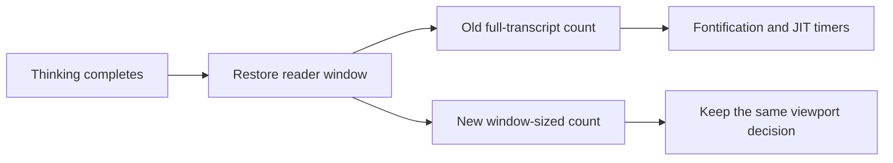

# Responsive viewport restoration in long chats

## Abstract

The paired GUI benchmark records thinking-completion time falling from **1,123.628 ms to 76.037 ms**, a **93.23% reduction** in the median of five interleaved runs per side. Every run preserved the reader's exact position and passed all 19 correctness checks. This result concerns one display handler, not model speed or physical keyboard latency.

The source change replaces full-transcript screen-line counts with counts that stop when the window has enough rows to make its decision. The existing viewport policy, logical thinking anchors, and position mapping remain in place.

## Why a viewport decision blocked the chat

The original live investigation captured `thinking_end` inside window restoration, display-aware counting, fontification, and immediate redisplay-timer insertion. The affected Emacs had tens of thousands of queued `jit-lock-force-redisplay` timers. That capture identified a frontend backlog, not an active subagent deadlock.

A separate baseline probe reproduced the mechanism with synthetic history. Its thinking-end handler took 2,528.219 ms and created 786 chat-owned JIT timers. One full-tail `count-screen-lines` call took 2,521.320 ms. This diagnostic probe is separate from the paired timing samples below.

The old code needed to know whether one window was full, but measured every display row through the remaining transcript. Emacs can fontify text during display motion. A fontifier that changes an earlier region schedules another redisplay timer. Ordered timer insertion becomes more expensive as the queue grows. The synchronous process filter cannot promptly return to ordinary input while that handler runs.



The shared measurement and tail policy live in [`pilish-ui.el`](../../pilish-ui.el#L2371-L2434). Rewrite capture and restoration remain in [`pilish-render.el`](../../pilish-render.el#L9729-L9843).

## The chosen design retains only useful precision

`pilish--count-screen-lines-up-to` returns an integer capped at the caller's limit. A result below the limit is exact. A result equal to the limit means that the native count is at least that large.

The helper follows Emacs's endpoint normalization, final-newline handling, temporary narrowing, truncated-end correction, and final-row correction. It changes the motion budget rather than replacing display rows with newline counts. A zero limit performs no display work. The helper preserves point and the incoming restriction.

The five callers use the following limits, where `H` is the positive window body height.

| Decision | Limit | Information needed |
|---|---:|---|
| Saved start fills the window within one blank row | `max(0, H - 1)` | Whether enough rows remain |
| Tail end remains visible | `H + 1` | The first count that fails the fit check |
| Captured point row | `H` | Exact visible rows and one offscreen category |
| Fallback rows above point | `max(0, H - 1)` | The maximum row the clamp can use |
| Fallback rows through the tail | `H` | Whether the tail fills the window |

The tail-fit check still counts the final newline. The other checks retain their previous final-newline policy. The pure row clamp, rewrite-state plist, and replacement records are unchanged.

Differential tests compare the bounded result with `min(limit, native count)` on small fixtures. Real-frame tests cover wrapping, hidden text, display replacements, horizontal scrolling, truncation, multiple widths, and independent reader and tail windows.

## Alternatives and scope

The design comparison selected the bounded adaptation of the native counter over a forward per-row stepper. The stepper introduced new endpoint rules and omitted the native truncated-end correction. It also left capture unbounded.

A layout-result object was rejected because capture, tail restoration, and reader fallback need different results. A persistent row index was rejected because edits, fontification, visibility, width, and display properties would all require cache invalidation.

The accepted tradeoff is that captured rows saturate at the capture-time window height. Stable-height restoration retains its previous effective result. Exact recovery of an arbitrary offscreen distance after a later window enlargement is not promised.

The row budget does not bound characters in one enormous logical line or prevent a fontifier from expanding its context. Only Emacs 30.1 was measured locally. Other supported versions still need their normal test matrix.

This change deliberately leaves visible-thinking restoration in place. Equal text can still acquire final properties and logical anchors. Event batching also stays out of scope because bounded measurement removed the dominant captured cost without changing protocol scheduling.

## Paired benchmark evidence

The baseline is `e527ec7b7bb760de0e80539d847a19f551ef1773`. It contains the new reader benchmark and the old renderer. The candidate is `51b801c348624c3acf9723f6b4212ead4aa0d6d9`.

Five baseline and five candidate runs alternated on the same machine, with the same dependency tree and compiled configuration. Each fresh graphical Emacs used a fake Pi process, 360 history messages, 445,422 rendered history bytes, and a reader at position 1. The reader scenario skips eager history-wide fontification. Final fontification and the exact visible-output check remain outside the measured stream interval.

| Metric | Baseline | Candidate |
|---|---:|---:|
| Thinking-end median | 1,123.628 ms | 76.037 ms |
| Thinking-end range | 1,050.112 to 1,147.556 ms | 4.596 to 87.667 ms |
| JIT timers created in the handler, every run | 374 | 0 |
| Stream wall median | 4,472.629 ms | 3,528.454 ms |
| Stream wall range | 4,424.874 to 4,551.397 ms | 3,506.237 to 3,551.540 ms |
| Successful runs | 5 of 5 | 5 of 5 |

The individual thinking-end samples retain the candidate's full variation rather than only its fastest runs.

| Pair | Baseline ms | Candidate ms |
|---|---:|---:|
| 1 | 1,075.412 | 4.834 |
| 2 | 1,147.556 | 80.580 |
| 3 | 1,050.112 | 87.667 |
| 4 | 1,134.963 | 76.037 |
| 5 | 1,123.628 | 4.596 |

All 10 runs passed all 19 checks, settled to idle, and produced the same exact visible projection. Its SHA-256 is `f274c8eb4458d49be179e89b31ce336f63ac244ff2db8a7140456759062ba7a8`. Reader start and point remained 1 before and after thinking completion and at settlement.

JIT counts are cumulative creations attributed through each timer's marker buffer. They are not process-wide queue sizes. Zero candidate creations are an observation, not a required acceptance threshold. Timing samples used no CPU profiler.

The diagnostic count trace and the earlier live stacks identify display-aware traversal and JIT work on the Emacs main thread as the baseline limiter. The fake pauses 80 ms between bursts, so stream wall time includes producer pacing. It is not a rendering-only measurement. The remaining candidate variation was not assigned to one function.

The local evidence is under `tmp/perf-viewport-responsiveness/`. The primary machine-readable comparison is `final-benchmark-v2/comparison.json`. Its manifest records every result path, commit, and exit status. `probe-full-start/viewport.el` records the separate diagnostic count trace.

## Correctness and user-facing QA

The implementation checkpoint passed `make check`, including compilation, Checkdoc, package lint, and all 2,427 unit tests. `make test-integration-fake` passed all 16 fake-backed contracts. Its 16 real-backend variants were intentionally not run.

The feature-map pass exercised all 25 commands across compose, streamed output, tool blocks, session browsers, and saved conversations. Every required GUI test passed with zero skips. The evidence check confirmed all 11 required PNGs, their 11 Elisp captures, and successful resume and reload results.

Three ordinary `full` stream-delta control runs passed their existing 16 checks. The new reader scenario adds three checks without changing that inventory. The full unit and feature-map passes preceded the final comment cleanup. The affected threshold test, all eight benchmark tests, and the real-frame reader test passed again after that cleanup. The paired benchmark above measures the final candidate commit.

The focused red evidence shows that the old reader path requested 9,826 display rows against a 17-row budget. The final real-frame regression also verifies unchanged character content and character tick, final thinking metadata, selected input, unsent draft, reader position, and a filled following window.

The feature map and its limits remain in [the verification skill](../../.agents/skills/verify-pilish/SKILL.md). Fake-backed checks do not prove provider authentication, real model behavior, or a separate multi-subagent dispatch issue. No physical keystroke latency is claimed.

## Reproduction

The reader workload runs through the existing GUI benchmark entry point.

```sh
./bench/run-stream-delta-bench.sh --scenario reader -c 1 --out-dir tmp/reader-check
```

The recorded paired comparison used these two worktrees. Both were compiled with the candidate's dependency tree before timing.

```sh
BASE=/home/daniel/co/pilish/.worktrees/viewport-responsiveness-baseline
FIXED=/home/daniel/co/pilish/.worktrees/viewport-responsiveness
export PACKAGE_USER_DIR="$FIXED/.cache/elpa/30"
make -C "$BASE" compile
make -C "$FIXED" compile
for pair in 1 2 3 4 5; do
	for root in "$BASE" "$FIXED"; do
		"$root/bench/run-stream-delta-bench.sh" --scenario reader -c 1 \
			--out-dir "$root/tmp/reader-repeat/pair-$pair"
	done
done
```

A new comparison must verify the two commit identities and use fresh output directories. Each result directory contains JSON, a timing TSV, a report, logs, and the fake-process record. A run is valid only when every check passes. The `reader` scenario rejects batch mode because batch output cannot prove window geometry.
